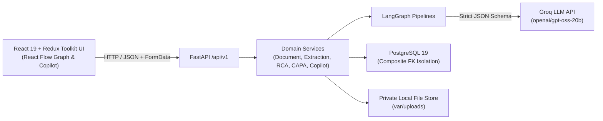
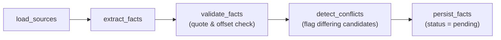
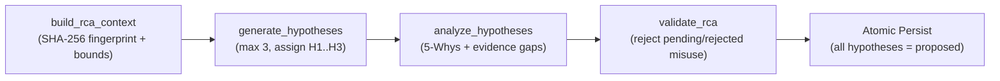
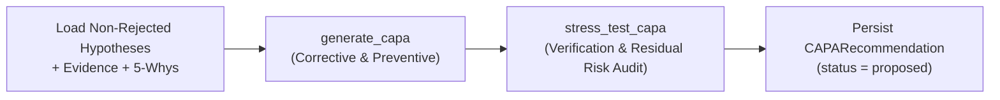

# ProofChain RCA — System Architecture

## 1. High-Level System Architecture

## 2. Multi-Pipeline LangGraph Orchestration

### A. Source-Grounded Fact Extraction (`app/agents/graph.py`)

### B. Evidence-First RCA Reasoning (`app/agents/rca_graph.py`)

### C. Two-Stage CAPA Generation & Stress Testing (`app/agents/capa_graph.py`)

## 3. Database Isolation & Referential Integrity

Every child table (`source_documents`, `evidence_items`, `rca_analysis_runs`, `rca_hypotheses`, `hypothesis_evidence`, `why_steps`, `evidence_gaps`, `capa_recommendations`) enforces **same-investigation scoping** via composite foreign keys `(entity_id, investigation_id)` and SQLite/PostgreSQL `CHECK` constraints:

- `evidence_items.review_status`: `pending | accepted | rejected`
- `rca_hypotheses.status`: `proposed | under_review | supported_by_records | contradicted | rejected | confirmed_by_investigator`
- `why_steps.answer_basis`: `source_supported` (requires `evidence_item_id`) vs `hypothesis | unknown` (`evidence_item_id IS NULL`)
- `capa_recommendations.status`: `proposed | approved | in_progress | completed | rejected`
